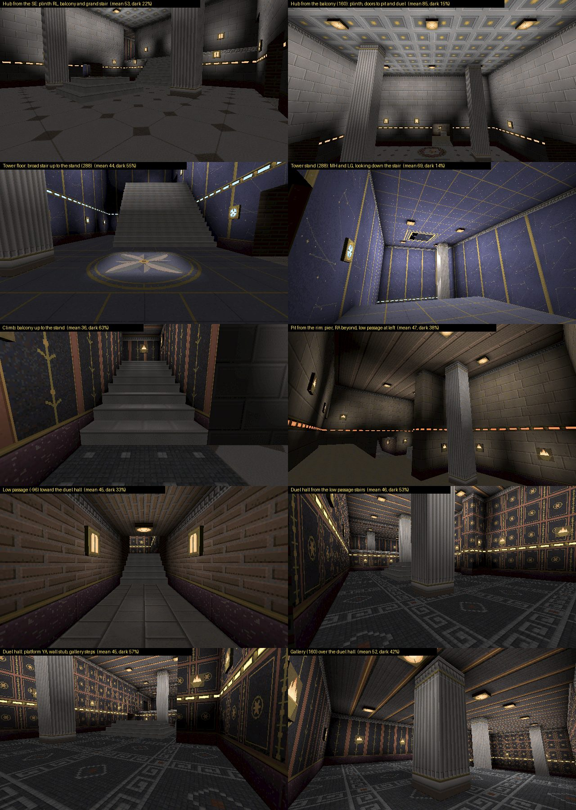
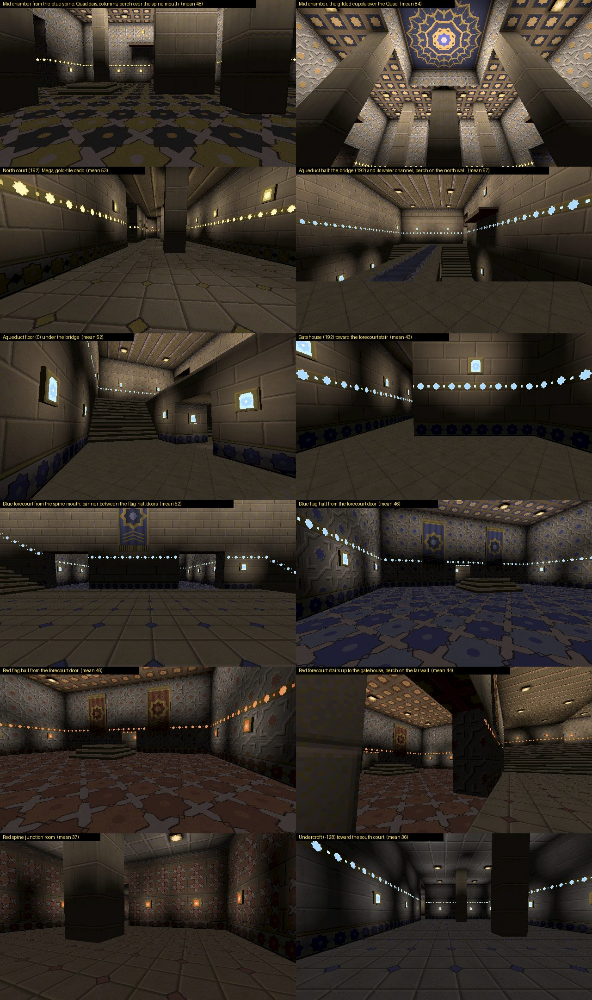
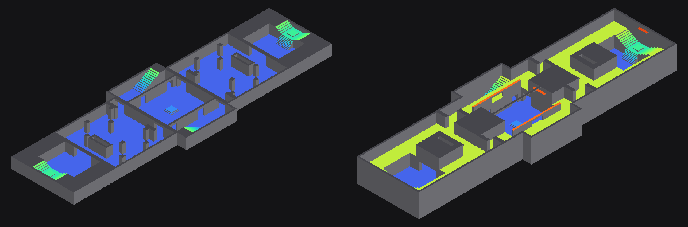
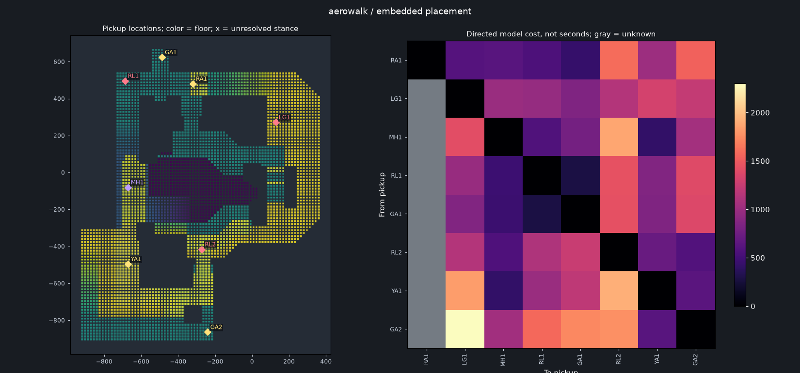

# qmap-ai-toolkit

**Procedural Quake 1 / QuakeWorld multiplayer map generation, texture synthesis, BSP verification, and demo analysis — built for human + AI map-making workflows.**

> [!IMPORTANT]
> **Using this toolkit with an AI agent to build a Quake map? Start with [`GUIDE.md`](GUIDE.md).**
> Read **Section 3** (designing fresh skeletons, *Design for height*, sizing by travel distance, and item economy) before designing anything, and **Section 9** (31 hard-won gotchas) before texturing or running a visual pass.

---

## What It Builds

Every map in this repository is generated from Python code — geometry, wall banding, ramps, angled prisms, lights, entities, and **every single texture** (synthesized procedurally and quantized to the 256-colour Quake palette, with zero copied id Software or third-party assets).

The toolkit and [`GUIDE.md`](GUIDE.md) grew out of building **nine multiplayer maps** (Clan Arena, FFA, and CTF) for an active QuakeWorld group across **~85 delivered builds**, **29 analyzed MVD match demos**, and quantitative surveys against five classic QuakeWorld maps (`aerowalk`, `ztndm3`, `dapak12`, `naked3`, `naked4`).

<table>
  <tr>
    <td width="50%" valign="top">
      <a href="gallery/ca_lyceum_views.jpg"></a><br>
      <sub><b><code>ca_lyceum</code></b> (Clan Arena / TDM 8–12) — error-diffused cream marble, sky oculus, hub + three distinct satellites. <a href="examples/ca_lyceum">Source</a></sub>
    </td>
    <td width="50%" valign="top">
      <a href="gallery/ctf_circuit_views.jpg"></a><br>
      <sub><b><code>ctf_circuit</code></b> (CTF 8–12, mirror symmetry) — "theta" racetrack, glazed team-coloured tile, light strips climbing stairs, gilded cupola. <a href="examples/ctf_circuit">Source</a></sub>
    </td>
  </tr>
</table>

<p align="center">
  <a href="gallery/ca_lyceum_plan.jpg"></a><br>
  <sub>Auto-generated multi-level floor plan (<code>template/plan.py</code>) for <code>ca_lyceum</code> — heights, spawns with facing arrows, weapons, armour, and health. See all nine maps in <a href="gallery/GALLERY.md"><code>gallery/GALLERY.md</code></a>.</sub>
</p>

---

## How the Workflow Works

The codebase is a **starting point, not a framework and not a cage**. Each map starts fresh from `template/` rather than copying the previous map (copying anchored three early maps onto the same layout skeleton), and maps extend the core whenever a design needs a new primitive.

The iterative human + AI loop documented in [`GUIDE.md` Section 2](GUIDE.md#2-working-with-the-human-the-process-that-worked):

1. **Spec** — Mode (CA / FFA / TDM / CTF), player count, symmetry, favourite/disliked references. Size the map by **travel distance**, not floor area.
2. **Concept in plan *and* section** — Sketch 2–3 structurally distinct skeletons (checked against [`gallery/GALLERY.md`](gallery/GALLERY.md)) showing vertical levels, overlooks, and climbing routes before writing a single brush.
3. **Layout blockout** — Build with neutral height-marked zone textures (`template/texgen_blockout.py`), run every automated geometry/hull check, and ship `.bsp` + `.map` + `.wad` alongside a plan, vertical sections, an isometric cutaway, and software-rendered views.
4. **Layout fix rounds** — Settle structure and verticality before texturing; structural edits after a visual pass force texture rework. Every build gets a new filename (`name_bN`) because QuakeWorld clients cache maps by name.
5. **Visual pass** — Generate an original procedural texture set and lighting pass, then prove with `qmap/collide_cmp.py` that both player and projectile/liquid collision stayed identical.
6. **In-client screenshot & demo rounds** — Fix whole classes of visual issues spotted in ezQuake screenshots (mocking up 2–3 rendered options from the player's camera angle when feedback is subjective), and analyze real match MVD demos with `demos/` once the group plays the map.

---

## Repository Layout

```text
qmap-ai-toolkit/
├── GUIDE.md          Field guide for designing, building, verifying, and texturing maps (read first)
├── VERSION           Single source of truth for the toolkit version (SemVer)
├── CHANGES.md        Release history
├── template/         Clean starting point for a new map (builds as-is into a demo map)
├── qmap/             Shared checks, spatial/verticality/item analytics, renderer, texture & WAD tools
├── examples/         Four finished maps that rebuild byte-identical from source (use for techniques)
├── gallery/          Plans, preview renders, height benchmark, and item-placement reference study
├── demos/            QuakeWorld MVD demo parser and match / movement-verticality analysis
└── tests/            Self-contained regression test suite (stdlib + NumPy, no qbsp required)
```

### `template/` — Start a New Map Here

A plain-Python map generator split into small composable files that `build.sh` concatenates and runs:

| File | Role |
|---|---|
| `_core.py` | Per-map settings (`NAME`, `TITLE`, `SYM`, bounds, light scale), 16-unit multi-floor column grid, building primitives (`carve`, `fill`, `stairs`, `terrace`, `pyramid`, `ramp`, `prism`, `chamfer`, `diag_wall`, `teleporter`, `jumppad`, `liquid`, `panel`, `inlay`, `oculus`, `strip_ramp`, `split_halves`), and texture mapping |
| `_layout.py` | Room layout, stairs/ramps, lamps, and spawns (ships with a small demo featuring an octagonal chamfered hall, sloped ramp with side alcove, and octagonal pillar) |
| `_itemh.py`, `_items.py` | Item placement helper and pickup list |
| `_out.py` | `.map` + `.json` writer with room-facing per-face texturing, wall bands (kickplate / wall / fullbright light strip / cornice / overhang architrave), Valve 220 texture axes on prisms, sloped ramp bands, and 16-unit floor minlight skins |
| `texgen_blockout.py` | Eight colour-coded blockout zone textures with 32/64/128-unit height and grid marks so layouts are judged purely as layouts |
| `build.sh` | End-to-end pipeline: generator → `qbsp` → `vis` → `light` → `check.py` → `vprofile.py --check --targets` |
| `plan.py`, `views.py` | Auto-level top-down floor plan and software-rendered preview sheet with ezQuake-calibrated brightness readouts |

Symmetry modes in `_core.py`: `'none'` (asymmetric), `'rotate'` (180° rotation about origin), and `'mirror'` (mirror across `x = 0`, keeping north = north for both teams).

### `qmap/` — Shared Analysis, Verification & Asset Pipeline

| Category | Tool | What it does |
|---|---|---|
| **Geometry & Collision** | `check.py` | Grid-level checks: spawn clearance and mutual sightlines, walk/jump/teleport/push reachability, dead-end traps, unreached floor at all heights, stair/ramp foot clearance, 16-unit player-blocking slots, item margins, and hook-only perches |
| | `vprofile.py` | Real 32×32×56 player-hull check (`--check`: catches tight gaps near angled brushes and low ceilings over stairs), verticality benchmark against five classics (`--targets`), and travel-distance sizing (`travel_median` / `travel_p90`) on any BSP29 |
| | `collide_cmp.py` | Dual-hull voxel collision comparator for visual-only builds: verifies both player collision (hulls 1/2) and hull 0 (`proj` solid, `sky*`, `*water`, `*slime`, `*lava`) across boxes and convex half-space brushes (ramps, prisms, veneers) down to sub-unit `--step` |
| **Spawns, Routes & Pacing** | `pick_spawns.py`, `pick_spawns_sym.py` | Solvers for the largest set of spawns with zero mutual eye-level line of sight (asymmetric or `rotate`/`mirror` symmetric) |
| | `routes.py`, `flagtime.py` | Named walking routes and timings between flags or arbitrary coordinates (carrier pace vs solo hook pace) |
| | `sightlines.py` | Longest straight eye-level sightlines per floor level along X and Y |
| | `contact.py` | Clan Arena pacing proxy comparing spawn spread against a reference map |
| **Item Economy** | `itemprofile.py` | BSP29 pickup inventory, directed RL/LG/armor/MH route matrices on the player-hull graph, RL/LG/resource trio diagnostics, and non-destructive `--move` what-if evaluation (see [`qmap/ITEMS.md`](qmap/ITEMS.md)) |
| | `itemcheck.py` | Offline verification of generated pickups against a captured MVDSV `edicts` dump after item settling |
| **Visualization** | `render.py` | Software z-buffered BSP29 renderer (textures + compiled lightmaps) calibrated to ezQuake brightness |
| | `section.py`, `iso.py` | Vertical slice diagrams and multi-height isometric "dollhouse" cutaways from the generator's JSON |
| **Textures & WADs** | `fsq.py` | 3×3-tiled serpentine Floyd-Steinberg error-diffusion quantizer over Quake palette subsets (synthesizes cream marble, plaster, and warm wood that nearest-colour quantization cannot hit) |
| | `makewad.py` | Packs palette-quantized PNGs (with `_fbr` fullbright support) into a Quake WAD2 using `quake_palette.lmp` |
| | `texgen.py`, `texgen_cistern.py`, `texgen_runic.py` | Reusable procedural texture generators and palette quantization helpers from earlier maps |
| | `strip_ill.py` | Legacy helper for stripping illusionary entities from `.map` files |

### `examples/` — Four Reproducible Reference Maps

Each folder rebuilds **byte-identical** `.map` source from this repository. Use them as a reference cookbook for techniques — not as layout templates:

- **`examples/ca_lyceum`** — Asymmetric Clan Arena / TDM (8–12); hub + three distinct satellites; error-diffused marble, sky oculus, columns with bases and capitals, close-up detail cameras (`details_lyceum.py`).
- **`examples/ctf_circuit`** — Mirror-symmetric CTF (8–12); "theta" racetrack around a solid core; sandstone + masked glazed team tile, light strips climbing stairs (`strip_ramp_pos`), banners, floor inlays, gilded cupola, route-timing figures (`routes_fig.py`).
- **`examples/ctf_strata`** — Rotational CTF (8–12); two stacked levels linked by light wells; `split_halves` team lighting, `SPLIT_Z`/`TRIM_Z` stratified walls, sunlight (`SUN`), two-ended direction signs with visibility checker (`signcheck.py`), texture contact sheet (`texsheet.py`).
- **`examples/ctf_bastion`** — Rotational CTF (8–12); rival forts with black-and-gold mid, undercroft, high route, emblems, and hook-only perches (early v1-era generator kept intact for reproducibility).

### `gallery/` & `demos/`

- **`gallery/`** — Top-down plans and preview contact sheets for all nine maps (`ca_agora`, `ca_vigil`, `ca_crucible`, `relay`, `ca_cistern`, `ctf_bastion`, `ca_lyceum`, `ctf_circuit`, `ctf_strata`) documented in [`gallery/GALLERY.md`](gallery/GALLERY.md), plus the verticality benchmark (`gallery/profiles/`) and five-classic item-placement survey (`gallery/items/`).
- **`demos/`** — Minimal QuakeWorld MVD reader (`mvd.py`), Clan Arena (`ca_run.py`) and CTF (`ctf_run.py`) analysis scripts, and `vert.py` for measuring in-play floor height change per 1,000 units travelled and airborne share.

---

## Engineering Highlights

### 1. Quantitative Verticality & Sizing by Travel (`vprofile.py`, `section.py`, `iso.py`)

After nine maps, playtesters felt the layouts still played too flat. Profiling all nine compiled BSPs against five beloved QuakeWorld classics (`aerowalk`, `ztndm3`, `dapak12`, `naked3`, `naked4`) revealed why: in the classics, **item-to-item routes change height 251–551 units per 1,000 units travelled**, versus **61–229** in our nine maps.

Crucially, **stacked is not vertical**: `ctf_strata` stacks 32% of its footprint (more than any classic), yet scored just **61** on route height change because players mostly ran flat along two stacked slabs. Looking at maps in section and isometric cutaway exposed the slab structure immediately — and measuring **travel distance** (`travel_median`, `travel_p90`) replaced floor area for sizing maps after stacked/teleporter-rich layouts proved far quicker to traverse than their square footage implied.

<p align="center">
  <a href="gallery/profiles/verticality_compare.jpg"></a><br>
  <sub><code>vprofile.py</code> benchmark comparing nine toolkit maps against five classic QW maps across stacking, effective levels, dominant-level share, overlooks, route height change, and angled walls.</sub>
</p>

<p align="center">
  <a href="gallery/profiles/ctf_strata_iso.png"></a><br>
  <sub><code>qmap/iso.py</code> cutaways of <code>ctf_strata</code> at two cut heights, illustrating its two stacked slabs and central open-sky atrium.</sub>
</p>

### 2. Dual-Hull Collision Proofs for Visual Passes (`collide_cmp.py`)

When an AI retextures a settled layout, proving that zero gameplay collision changed is subtler than comparing axis-aligned walls. `qmap/collide_cmp.py` models `ericw-tools qbsp`'s actual measured rules (verified by compiling a full entity × texture test matrix against live `qbsp`):

- **Player hull (hulls 1 & 2)** vs **projectile / point-trace hull (hull 0)** are checked independently across six classes (`solid`, `proj`, `sky`, `water`, `slime`, `lava`) — catching bugs like retexturing a wall to `clip` (identical to players, transparent to rockets), `sky*` (identical to players, deletes rockets), or swapping `*water` to `*lava` (same volume, lethal).
- **Exact convex half-space voxelization** handles ramps, chamfered prisms, and 1-unit wall veneers down to sub-unit steps (`--step 0.5`), using non-inflating ROI merging and exact lattice overlap masking so large maps stay fast and within memory bounds.
- Every ignored brush (such as `func_detail_illusionary` fixtures or runtime submodels like `trigger_teleport`) is explicitly accounted for on `stderr`. Always check the **exit code (`0` = identical)** rather than just stdout text.

### 3. Item Economy Diagnostics (`itemprofile.py`, `itemcheck.py`)

For TDM and FFA maps, `qmap/itemprofile.py` computes embedded inventories, directed RL/LG/armor/MH route matrices on the compiled player-hull graph, world eye-ray checks, and hypothetical `--move` comparisons without editing a BSP. These outputs are **design diagnostics, not mandatory balance scores** — see [`qmap/ITEMS.md`](qmap/ITEMS.md) and [`gallery/items/README.md`](gallery/items/README.md) for the five-classic study and model caveats.

<p align="center">
  <a href="gallery/items/aerowalk.items.png"></a><br>
  <sub><code>qmap/itemprofile.py</code> output on <code>aerowalk</code>: pickup locations over reachable floor and the directed movement-cost matrix between key resources.</sub>
</p>

---

## Quick Start

### Prerequisites

- **Python 3** with `numpy`, `pillow`, `scipy`, `matplotlib`, and `numba`
- **[`ericw-tools`](https://github.com/ericwa/ericw-tools)** (`qbsp`, `vis`, `light`) built from source
- A **QuakeWorld client** (e.g. [ezQuake](https://ezquake.com/)) for playtesting and screenshot review

### 1. Run the Regression Test Suite

Requires only Python 3 + NumPy (no `ericw-tools` needed):

```bash
python3 -m unittest discover -s tests -v
```

### 2. Build the Template Demo Map

Verify your compiler and Python environment end to end using `template/` (which builds into `mymap_b1` as-is):

```bash
export ERICW=/path/to/ericw-tools/build
cd template
python3 texgen_blockout.py bktex
python3 ../qmap/makewad.py mymap_b1.wad $(cat wad_args.txt)
bash build.sh
python3 plan.py mymap_b1.json plan.png "Template demo"
python3 ../qmap/section.py mymap_b1.json section.png y=0 x=0
python3 ../qmap/iso.py mymap_b1.json iso.png cut=100 cut=300
python3 views.py mymap_b1.bsp views.png
```

`build.sh` compiles the map, checks for leaks, runs `check.py`, and finishes with `vprofile.py --check --targets` (set `VPROFILE=0` to skip `vprofile.py`).

### 3. Rebuild a Finished Example

Verify byte-identical reproducibility on `ca_lyceum` (see [`GUIDE.md` Section 1](GUIDE.md#1-whats-in-the-box) and [Section 13](GUIDE.md#13-example-notes) for the other three examples):

```bash
export ERICW=/path/to/ericw-tools/build
cd examples/ca_lyceum
python3 texgen_lyceum.py ltex
python3 ../../qmap/makewad.py ca_lyceum_b5.wad $(sed 's/.*/&=ltex\/&.png/' ltex_names.txt)
bash build.sh
python3 views_lyceum.py ca_lyceum_b5.bsp views.png
```

### 4. Start Your Own Map

Copy `template/` to a new folder, then follow [`GUIDE.md`](GUIDE.md) — start with **Sections 2–3** (spec, concept sketches in plan and section, verticality and travel targets) and **Section 12** (step-by-step build checklist).

---

## Versioning

Starting with **`4.0.0`**, `qmap-ai-toolkit` follows [Semantic Versioning](https://semver.org/) (`MAJOR.MINOR.PATCH`, git tags `vMAJOR.MINOR.PATCH`):

- **[`VERSION`](VERSION)** at the repository root is the single source of truth for the toolkit version.
- Documentation headers (`README.md`, `GUIDE.md`, `qmap/ITEMS.md`) and `template/` file banners intentionally omit hardcoded release numbers so they never drift out of sync.
- Historical releases `v1` through `v3.7` remain as originally tagged; see **[`CHANGES.md`](CHANGES.md)** for the complete changelog.

---

## Licensing

- **Code**: yours to use.
- **Textures**: all textures are generated procedurally from code — no id Software or third-party map textures are included.
- **Palette**: [`qmap/quake_palette.lmp`](qmap/quake_palette.lmp) is from [LibreQuake](https://github.com/MissLav/LibreQuake) (BSD-3-Clause; see [`qmap/quake_palette.LICENSE.txt`](qmap/quake_palette.LICENSE.txt)).
- **Map compilers**: requires [`ericw-tools`](https://github.com/ericwa/ericw-tools) (GPL, not included).
