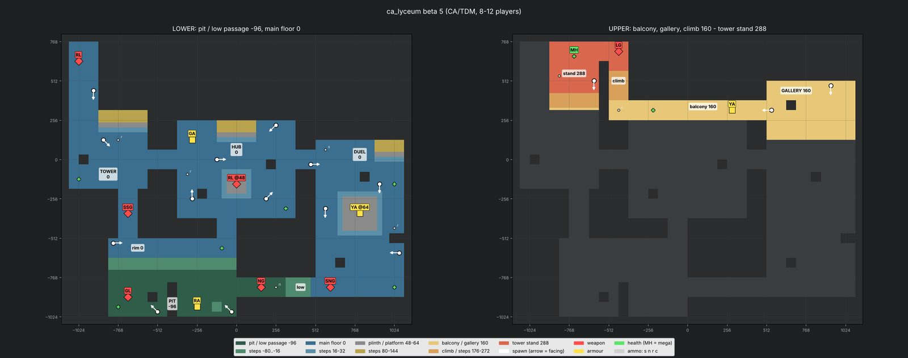
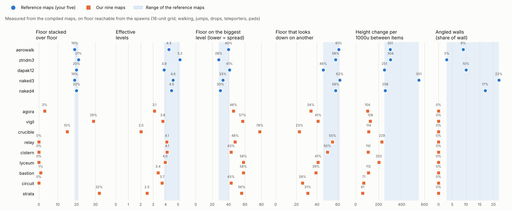

# qmap-ai-toolkit

**Procedural Quake 1 / QuakeWorld multiplayer map generation, texture synthesis, BSP verification, and demo analysis — built for human + AI map-making workflows.**

> [!IMPORTANT]
> **AI agents building a Quake map with this toolkit: read [`GUIDE.md`](GUIDE.md) first.**
> Read **Section 3** (designing fresh skeletons, *Design for height*, sizing by travel distance, and item economy) before designing anything, and **Section 9** (31 hard-won gotchas) before texturing or running a visual pass.

---

## What It Builds

Every map in this repository is generated from Python code — geometry, wall banding, ramps, angled prisms, lights, entities, and **every single texture** (synthesized procedurally and quantized to the 256-colour Quake palette, with zero copied id Software or third-party assets).

The toolkit and [`GUIDE.md`](GUIDE.md) grew out of building **nine multiplayer maps** (Clan Arena, FFA, and CTF) for an active QuakeWorld group across **~85 delivered builds**, **29 analyzed MVD match demos**, and quantitative surveys against five classic QuakeWorld maps (`aerowalk`, `ztndm3`, `dapak12`, `naked3`, `naked4`).

<table>
  <tr>
    <td width="50%" valign="top">
      <a href="gallery/ca_lyceum_views.jpg"></a><br>
      <sub><b><code>ca_lyceum</code></b> (Clan Arena / TDM 8–12) — error-diffused cream marble, sky oculus, hub + three distinct satellites. <a href="examples/ca_lyceum">Source</a></sub>
    </td>
    <td width="50%" valign="top">
      <a href="gallery/ctf_circuit_views.jpg"></a><br>
      <sub><b><code>ctf_circuit</code></b> (CTF 8–12, mirror symmetry) — "theta" racetrack, glazed team-coloured tile, light strips climbing stairs, gilded cupola. <a href="examples/ctf_circuit">Source</a></sub>
    </td>
  </tr>
</table>

<p align="center">
  <a href="gallery/ca_lyceum_plan.jpg"></a><br>
  <sub>Auto-generated multi-level floor plan (<code>template/plan.py</code>) for <code>ca_lyceum</code> — heights, spawns with facing arrows, weapons, armour, and health. See all nine maps in <a href="gallery/GALLERY.md"><code>gallery/GALLERY.md</code></a>.</sub>
</p>

---

## Getting Started

You don't need to write map generators or run BSP compilers by hand — your AI coding agent handles the Python code, compilation, geometry checks, and renders by following [`GUIDE.md`](GUIDE.md). Your job is directing the design, running around in each build, and giving playtest and visual feedback.

### What You Need

- An **AI coding agent** with shell and file access (e.g., Claude Code, Codex, or similar) running in an environment with **Python 3** (`numpy`, `pillow`, `scipy`, `matplotlib`, `numba`) and **[`ericw-tools`](https://github.com/ericwa/ericw-tools)** (`qbsp`, `vis`, `light`).
- A **QuakeWorld client** (such as [ezQuake](https://ezquake.com/)) to load the generated `.bsp` builds, explore the map, and grab screenshots for feedback.

### Example Prompts

Point your agent at this repository (the GitHub URL or a local clone) and tell it what kind of map you want to make. You can start with a single sentence or give detailed design goals up front:

#### Basic — mode, player count, and the repo link

```text
I'm looking to make a Clan Arena 8-12 player map that also supports TDM and FFA.
https://github.com/Voidious/qmap-ai-toolkit
```

That's enough for the agent to read `GUIDE.md`, ask any quick clarifying questions (like favourite or disliked maps), and pitch 2–3 distinct layout concepts in plan and section before building anything.

#### Medium — adding symmetry, pacing references, and a visual direction

```text
Let's build a mirror-symmetric CTF map for 8-12 players using
https://github.com/Voidious/qmap-ai-toolkit. I'd like fast flag runs
(~10-12 seconds walking, with clean hook lines) and real vertical fights in mid
rather than flat corridors — closer to aerowalk or dapak12's height play than
stacked slabs. Keep the first builds in blockout textures until we're happy with
the layout, and aim for a volcanic basalt-and-copper look when we get to the
visual pass.
```

#### Complex — competitive layout, item economy, and review constraints

```text
Using https://github.com/Voidious/qmap-ai-toolkit, let's design an asymmetric
4v4 TDM map (also playable for 2v2 and 6-8 player FFA) sized around ztndm3 /
aerowalk travel times. Give it three distinct elevation tiers with strong
overlooks between a sunken red-armor pit, a high quad/mega balcony, and separate
RL and LG control routes — check the resource spacing with itemprofile.py and
keep straight sightlines under ~1200 units. Pitch 3 structurally different
concepts in both plan and section (distinct from gallery/GALLERY.md) before
building the first blockout.
```

---

## Choosing an AI Model

Building a good Quake map in Python asks a lot of an LLM at once: 3D spatial reasoning in code, disciplined multi-tool verification, procedural texture synthesis, and visual self-critique across many iterative builds. Frontier reasoning/coding models handle this well; smaller, faster, or older-generation models tend to stall or produce flat, broken geometry.

### Tested Models (as of November 2026)

| Status | Models |
|---|---|
| **Working** | Opus 5.5, GPT 6.x (Sol, Astra), Gemini 4 Neon, GLM 5.4 |
| **Not working** | GLM 5.3, GLM 5.3 Flash |

Even as newer models release, the sharp split between **GLM 5.4** and **GLM 5.3 / 5.3 Flash** is a useful baseline for the capability threshold this workflow needs.

### How to Evaluate a Model for Map-Making

If you're trying a newer or unlisted model, test it through one full concept → blockout → visual-pass cycle and watch for four things:

1. **3D spatial reasoning in code** — Can it hold multi-level coordinates, overlooks, ramps, stair headroom, and room connections in its head across Python geometry code, rather than collapsing into flat boxes or fighting recurring leaks and hull traps?
2. **Process & tool discipline** — Does it actually follow [`GUIDE.md`](GUIDE.md): sketching genuinely distinct concepts in plan *and* section before coding, running the full build/check pipeline (`check.py`, `vprofile.py`, `collide_cmp.py`), and computing distances/sightlines instead of guessing in prose?
3. **Visual self-critique** — Can it look at its own rendered plans, sections, preview shots (`views.py`), and your in-client ezQuake screenshots to diagnose lighting brightness, palette traps, and texture alignment bugs — fixing the whole class of bug rather than patching one wall?
4. **Endurance across iterations** — Can it carry a map through 5–15+ playtest and visual-polish builds without breaking earlier rooms, forgetting constraints, or silently altering gameplay collision during a texture pass?

---

## How the Workflow Works

The codebase is a **starting point, not a framework and not a cage**. Each new map starts fresh from `template/` rather than copying the previous map (copying anchored three early maps onto the same layout skeleton), and the agent extends the core whenever a design calls for a new architectural primitive.

The iterative human + AI loop (detailed in [`GUIDE.md` Section 2](GUIDE.md#2-working-with-the-human-the-process-that-worked)):

1. **Spec** — You share the mode (CA / FFA / TDM / CTF), player count, symmetry, and favourite or disliked maps. The agent sizes the map by **travel distance**, not floor area.
2. **Concept in plan *and* section** — Before writing any geometry, the agent sketches 2–3 structurally distinct skeletons (checked against [`gallery/GALLERY.md`](gallery/GALLERY.md)) showing vertical levels, overlooks, and climbing routes so you can pick the best direction up front.
3. **Layout blockout** — The agent generates a playable `.bsp` with neutral height-marked zone textures (`template/texgen_blockout.py`), runs automated geometry and player-hull checks, and delivers the build alongside a floor plan, vertical sections, an isometric cutaway, and software-rendered preview shots.
4. **Layout fix rounds** — You run around in-client and give layout feedback; the agent iterates on structure and verticality until the layout feels settled (structural edits after a visual pass force texture rework). Every build gets a new filename (`name_bN`) because QuakeWorld clients cache maps by name.
5. **Visual pass** — Once the layout is locked, you pick a visual theme from concrete proposals. The agent synthesizes an original procedural texture set and lighting pass, then verifies with `qmap/collide_cmp.py` that both player and projectile/liquid collision stayed identical.
6. **In-client screenshot & demo rounds** — You send ezQuake screenshots of anything that looks off — the agent fixes whole classes of visual issues at once, and mocks up 2–3 rendered options from your camera angle when a choice is subjective. Once your group plays real matches on the map, the `demos/` tools can analyze MVD recordings for pacing and movement verticality.

---

## Engineering Highlights

### 1. Quantitative Verticality & Sizing by Travel (`vprofile.py`, `section.py`, `iso.py`)

After nine maps, playtesters felt the layouts still played too flat. Profiling all nine compiled BSPs against five beloved QuakeWorld classics (`aerowalk`, `ztndm3`, `dapak12`, `naked3`, `naked4`) revealed why: in the classics, **item-to-item routes change height 251–551 units per 1,000 units travelled**, versus **61–229** in our nine maps.

Crucially, **stacked is not vertical**: `ctf_strata` stacks 32% of its footprint (more than any classic), yet scored just **61** on route height change because players mostly ran flat along two stacked slabs. Inspecting maps in section and isometric cutaway exposed the slab structure immediately — and measuring **travel distance** (`travel_median`, `travel_p90`) replaced floor area for sizing maps after stacked/teleporter-rich layouts proved far quicker to traverse than their square footage implied.

<p align="center">
  <a href="gallery/profiles/verticality_compare.jpg"></a><br>
  <sub><code>vprofile.py</code> benchmark comparing nine toolkit maps against five classic QW maps across stacking, effective levels, dominant-level share, overlooks, route height change, and angled walls.</sub>
</p>

<p align="center">
  <a href="gallery/profiles/ctf_strata_iso.png"></a><br>
  <sub><code>qmap/iso.py</code> cutaways of <code>ctf_strata</code> at two cut heights, illustrating its two stacked slabs and central open-sky atrium.</sub>
</p>

### 2. Dual-Hull Collision Proofs for Visual Passes (`collide_cmp.py`)

When an agent retextures a settled layout, proving that zero gameplay collision changed is subtler than comparing axis-aligned walls. `qmap/collide_cmp.py` models `ericw-tools qbsp`'s actual measured rules (verified by compiling a full entity × texture test matrix against live `qbsp`):

- **Player hull (hulls 1 & 2)** vs **projectile / point-trace hull (hull 0)** are checked independently across six classes (`solid`, `proj`, `sky`, `water`, `slime`, `lava`) — catching bugs like retexturing a wall to `clip` (identical to players, transparent to rockets), `sky*` (identical to players, deletes rockets), or swapping `*water` to `*lava` (same volume, lethal).
- **Exact convex half-space voxelization** handles ramps, chamfered prisms, and 1-unit wall veneers down to sub-unit steps (`--step 0.5`), using non-inflating ROI merging and exact lattice overlap masking so large maps stay fast and within memory bounds.
- Every ignored brush (such as `func_detail_illusionary` fixtures or runtime submodels like `trigger_teleport`) is explicitly accounted for on `stderr`, and the tool exits `0` only when every compared hull matches.

### 3. Item Economy Diagnostics (`itemprofile.py`, `itemcheck.py`)

For TDM and FFA maps, `qmap/itemprofile.py` computes embedded inventories, directed RL/LG/armor/MH route matrices on the compiled player-hull graph, world eye-ray checks, and hypothetical `--move` comparisons without editing a BSP. These outputs are **design diagnostics, not mandatory balance scores** — see [`qmap/ITEMS.md`](qmap/ITEMS.md) and [`gallery/items/README.md`](gallery/items/README.md) for the five-classic study and model caveats.

<p align="center">
  <a href="gallery/items/aerowalk.items.png"></a><br>
  <sub><code>qmap/itemprofile.py</code> output on <code>aerowalk</code>: pickup locations over reachable floor and the directed movement-cost matrix between key resources.</sub>
</p>

---

## Doing Your Own Map & Demo Analysis

The targets and pacing numbers in [`GUIDE.md`](GUIDE.md) came from one QuakeWorld group's 29 MVD demos and five classic reference maps (`aerowalk`, `ztndm3`, `dapak12`, `naked3`, `naked4`). If your group plays different maps, player counts, or mods (like CTF classics, 2v2/4v4 TDM, or FFA), you can run the same analysis on **your own `.bsp` maps and `.mvd` match demos** — both to calibrate design targets before building and to evaluate real playtests afterward.

### Profiling Your Favourite Maps (`.bsp`)

Both [`qmap/vprofile.py`](qmap/vprofile.py) and [`qmap/itemprofile.py`](qmap/itemprofile.py) work directly on any compiled Quake 1 / QuakeWorld **BSP29** file — you don't need `.map` source. Point your agent at your local copies of the maps your group loves (or hates):

- **Verticality & travel sizing (`vprofile.py`)** — Measure `travel_median`, `travel_p90`, effective levels, overlooks, route height change, and angled walls on your reference pool to calibrate sizing and verticality targets for your mode (especially useful for CTF, since the bundled five classics are deathmatch maps).
- **Item economy (`itemprofile.py`)** — Inspect embedded inventories, directed RL/LG/armor/MH route matrices, and pickup layouts across your favourite TDM/FFA maps, or test hypothetical moves on your own builds with `--move` (see [`qmap/ITEMS.md`](qmap/ITEMS.md) and [`gallery/items/README.md`](gallery/items/README.md)).

### Analyzing Your Group's Match Demos (`.mvd`)

The [`demos/`](demos) folder provides a minimal QuakeWorld MVD parser ([`demos/mvd.py`](demos/mvd.py)) plus working analyzers for Clan Arena ([`demos/ca_run.py`](demos/ca_run.py)), CTF ([`demos/ctf_run.py`](demos/ctf_run.py)), and in-play movement verticality ([`demos/vert.py`](demos/vert.py)):

- **What you get**: top-down heatmaps of player positions, kill lines by weapon, round lengths, time to first contact, 1vX endgame share, flag-carry paths, carrier pace and capture conversion, death zones, and in-play floor height change per 1,000 units (`floor_change_per_1000` and `airborne` share).
- **Best way to use them**: `ca_run.py` and `ctf_run.py` are **reference scripts** written around the original group's KTX demo filenames and directory layout rather than turn-key CLIs (and `mvd.py` expects standard short/8 coordinates). Drop a folder of your group's `.mvd` recordings into your workspace and ask your AI agent to run or adapt the scripts for your filenames, server mod, and questions — both on classic maps before designing and on your own custom maps after playtest nights.
- **Comparing apples to apples**: In-play verticality from `demos/vert.py` (~90–165 height units per 1,000 travelled in the original demos) is naturally lower than geometric item-route verticality from `vprofile.py` (251–551) because players linger and fight on a level. Always compare demo numbers to demo numbers and BSP numbers to BSP numbers.

```text
# Example prompt for analyzing your own references and playtest demos
I put our group's favourite CTF .bsp maps in ./ref_maps/ and ten recent KTX .mvd
demos in ./my_demos/ (including two playtest games on our new map). Profile the
reference maps with vprofile.py, adapt demos/ctf_run.py + vert.py to analyze our
demos, and tell me how our new map's flag-carry pace, death zones, and in-play
verticality compare to the classics we play.
```

---

## What's Inside the Repository

```text
qmap-ai-toolkit/
├── GUIDE.md          Field guide for AI agents designing, building, verifying, and texturing maps
├── VERSION           Single source of truth for the toolkit version (SemVer)
├── CHANGES.md        Release history
├── template/         Clean starting point for a new map (builds as-is into a small demo map)
├── qmap/             Shared checks, spatial/verticality/item analytics, renderer, texture & WAD tools
├── examples/         Four finished maps that rebuild byte-identical from source
├── gallery/          Plans, preview renders, height benchmark, and item-placement reference study
├── demos/            QuakeWorld MVD demo parser and match / movement-verticality analysis
└── tests/            Self-contained regression test suite (stdlib + NumPy, no qbsp required)
```

### `template/` — Clean Starting Point for Each Map

A plain-Python map generator split into small composable files that `build.sh` concatenates and runs:

| File | Role |
|---|---|
| `_core.py` | Per-map settings (`NAME`, `TITLE`, `SYM`, bounds, light scale), 16-unit multi-floor column grid, building primitives (`carve`, `fill`, `stairs`, `terrace`, `pyramid`, `ramp`, `prism`, `chamfer`, `diag_wall`, `teleporter`, `jumppad`, `liquid`, `panel`, `inlay`, `oculus`, `strip_ramp`, `split_halves`), and texture mapping |
| `_layout.py` | Room layout, stairs/ramps, lamps, and spawns (ships with a small demo featuring an octagonal chamfered hall, sloped ramp with side alcove, and octagonal pillar) |
| `_itemh.py`, `_items.py` | Item placement helper and pickup list |
| `_out.py` | `.map` + `.json` writer with room-facing per-face texturing, wall bands (kickplate / wall / fullbright light strip / cornice / overhang architrave), Valve 220 texture axes on prisms, sloped ramp bands, and 16-unit floor minlight skins |
| `texgen_blockout.py` | Eight colour-coded blockout zone textures with 32/64/128-unit height and grid marks so layouts are judged purely as layouts |
| `build.sh` | End-to-end pipeline: generator → `qbsp` → `vis` → `light` → `check.py` → `vprofile.py --check --targets` |
| `plan.py`, `views.py` | Auto-level top-down floor plan and software-rendered preview sheet with ezQuake-calibrated brightness readouts |

Symmetry modes in `_core.py`: `'none'` (asymmetric), `'rotate'` (180° rotation about origin), and `'mirror'` (mirror across `x = 0`, keeping north = north for both teams).

### `qmap/` — Shared Analysis, Verification & Asset Pipeline

| Category | Tool | What it does |
|---|---|---|
| **Geometry & Collision** | `check.py` | Grid-level checks: spawn clearance and mutual sightlines, walk/jump/teleport/push reachability, dead-end traps, unreached floor at all heights, stair/ramp foot clearance, 16-unit player-blocking slots, item margins, and hook-only perches |
| | `vprofile.py` | Real 32×32×56 player-hull check (`--check`: catches tight gaps near angled brushes and low ceilings over stairs), verticality benchmark against five classics (`--targets`), and travel-distance sizing (`travel_median` / `travel_p90`) on any BSP29 |
| | `collide_cmp.py` | Dual-hull voxel collision comparator for visual-only builds: verifies both player collision (hulls 1/2) and hull 0 (`proj` solid, `sky*`, `*water`, `*slime`, `*lava`) across boxes and convex half-space brushes (ramps, prisms, veneers) down to sub-unit `--step` |
| **Spawns, Routes & Pacing** | `pick_spawns.py`, `pick_spawns_sym.py` | Solvers for the largest set of spawns with zero mutual eye-level line of sight (asymmetric or `rotate`/`mirror` symmetric) |
| | `routes.py`, `flagtime.py` | Named walking routes and timings between flags or arbitrary coordinates (carrier pace vs solo hook pace) |
| | `sightlines.py` | Longest straight eye-level sightlines per floor level along X and Y |
| | `contact.py` | Clan Arena pacing proxy comparing spawn spread against a reference map |
| **Item Economy** | `itemprofile.py` | BSP29 pickup inventory, directed RL/LG/armor/MH route matrices on the player-hull graph, RL/LG/resource trio diagnostics, and non-destructive `--move` what-if evaluation (see [`qmap/ITEMS.md`](qmap/ITEMS.md)) |
| | `itemcheck.py` | Offline verification of generated pickups against a captured MVDSV `edicts` dump after item settling |
| **Visualization** | `render.py` | Software z-buffered BSP29 renderer (textures + compiled lightmaps) calibrated to ezQuake brightness |
| | `section.py`, `iso.py` | Vertical slice diagrams and multi-height isometric "dollhouse" cutaways from the generator's JSON |
| **Textures & WADs** | `fsq.py` | 3×3-tiled serpentine Floyd-Steinberg error-diffusion quantizer over Quake palette subsets (synthesizes cream marble, plaster, and warm wood that nearest-colour quantization cannot hit) |
| | `makewad.py` | Packs palette-quantized PNGs (with `_fbr` fullbright support) into a Quake WAD2 using `quake_palette.lmp` |
| | `texgen.py`, `texgen_cistern.py`, `texgen_runic.py` | Reusable procedural texture generators and palette quantization helpers from earlier maps |
| | `strip_ill.py` | Legacy helper for stripping illusionary entities from `.map` files |

### `examples/` — Four Reproducible Reference Maps

Each folder rebuilds **byte-identical** `.map` source from this repository — useful as a cookbook for architectural and texturing techniques, rather than as layout templates:

- **`examples/ca_lyceum`** — Asymmetric Clan Arena / TDM (8–12); hub + three distinct satellites; error-diffused marble, sky oculus, columns with bases and capitals, close-up detail cameras (`details_lyceum.py`).
- **`examples/ctf_circuit`** — Mirror-symmetric CTF (8–12); "theta" racetrack around a solid core; sandstone + masked glazed team tile, light strips climbing stairs (`strip_ramp_pos`), banners, floor inlays, gilded cupola, route-timing figures (`routes_fig.py`).
- **`examples/ctf_strata`** — Rotational CTF (8–12); two stacked levels linked by light wells; `split_halves` team lighting, `SPLIT_Z`/`TRIM_Z` stratified walls, sunlight (`SUN`), two-ended direction signs with visibility checker (`signcheck.py`), texture contact sheet (`texsheet.py`).
- **`examples/ctf_bastion`** — Rotational CTF (8–12); rival forts with black-and-gold mid, undercroft, high route, emblems, and hook-only perches (early v1-era generator kept intact for reproducibility).

### `gallery/` & `demos/`

- **`gallery/`** — Top-down plans and preview contact sheets for all nine maps (`ca_agora`, `ca_vigil`, `ca_crucible`, `relay`, `ca_cistern`, `ctf_bastion`, `ca_lyceum`, `ctf_circuit`, `ctf_strata`) documented in [`gallery/GALLERY.md`](gallery/GALLERY.md), plus the verticality benchmark (`gallery/profiles/`) and five-classic item-placement survey (`gallery/items/`).
- **`demos/`** — Minimal QuakeWorld MVD reader (`mvd.py`), Clan Arena (`ca_run.py`) and CTF (`ctf_run.py`) analysis scripts, and `vert.py` for measuring in-play floor height change per 1,000 units travelled and airborne share.

---

## Expanding the Toolkit & Guide

`qmap-ai-toolkit` was built iteratively: almost every primitive in [`template/`](template), check in [`qmap/`](qmap), and gotcha in [`GUIDE.md`](GUIDE.md) started as a real problem encountered while building one of the maps. You should treat your copy the same way — evolve it as your maps and your QuakeWorld group teach you new lessons.

### Extending the Generator & Tools

- **Let the map design lead**: Don't reshape a layout just to fit what `template/_core.py` already supports. Earlier maps added mirror symmetry, ramps, angled prisms, stair-climbing light strips, floor inlays, sky oculi, stratified walls, and team-split lighting because a specific map needed them. Known architectural frontiers listed in [`GUIDE.md` Section 3](GUIDE.md#3-design-fresh-takes-on-classics) include curved walls (beyond prism approximations), diagonal ramps, sloped ceilings, doors and lifts, and moving brushes.
- **Prototype in one map first, then promote**: Build a new primitive or texture/analysis helper inside your current map folder while iterating. Once it survives a full compile, playtest, and check cycle, ask your agent to fold the clean, general version back into `template/` or `qmap/`.
- **Keep reference maps reproducible & tests green**: Avoid modifying finished maps in `examples/` when evolving `template/` so they remain byte-identical build references, and run the regression suite (`tests/`) whenever you change shared tools in `qmap/` or versioning/documentation structure.

### Evolving `GUIDE.md` & `gallery/` for Your Group

- **Capture every real gotcha**: When a build wastes a feedback round on a subtle Quake, `ericw-tools`, ezQuake, or texture/lighting surprise, have your agent distill the root cause and fix into [`GUIDE.md`](GUIDE.md) (especially [Section 9](GUIDE.md#9-gotchas-each-cost-at-least-one-round-of-feedback)) so future map sessions don't repeat the same mistake.
- **Tailor the guide to your group**: If you maintain a fork for your own players, update `GUIDE.md` with your group's tastes — favourite and disliked maps, server mod settings (KTX, CA, TDM/FFA item rules), preferred lighting brightness, and calibration bands from your own map/demo analysis.
- **Log finished maps in `gallery/`**: Adding a plan, preview sheet, and one-line skeleton/look summary to [`gallery/GALLERY.md`](gallery/GALLERY.md) after each finished map gives your agent memory of what you've already built, preventing future maps from drifting into the same layout or visual theme.

---

## Running Tools & Tests Locally (Optional)

Normally your AI agent runs these commands directly using [`GUIDE.md`](GUIDE.md). If you'd like to verify your own environment, run the regression suite, or build the template demo by hand:

**Run the regression tests** (Python 3 + NumPy only — no `ericw-tools` required):

```bash
python3 -m unittest discover -s tests -v
```

**Build the `template/` demo map and its figures** (requires Python dependencies + `ericw-tools`):

```bash
export ERICW=/path/to/ericw-tools/build
cd template
python3 texgen_blockout.py bktex
python3 ../qmap/makewad.py mymap_b1.wad $(cat wad_args.txt)
bash build.sh
python3 plan.py mymap_b1.json plan.png "Template demo"
python3 ../qmap/section.py mymap_b1.json section.png y=0 x=0
python3 ../qmap/iso.py mymap_b1.json iso.png cut=100 cut=300
python3 views.py mymap_b1.bsp views.png
```

See [`GUIDE.md` Section 1](GUIDE.md#1-whats-in-the-box) and [Section 13](GUIDE.md#13-example-notes) for the commands to rebuild each finished map in `examples/` byte-for-byte.

---

## Versioning

Starting with **`4.0.0`**, `qmap-ai-toolkit` follows [Semantic Versioning](https://semver.org/) (`MAJOR.MINOR.PATCH`, git tags `vMAJOR.MINOR.PATCH`):

- **[`VERSION`](VERSION)** at the repository root is the single source of truth for the toolkit version.
- Documentation headers (`README.md`, `GUIDE.md`, `qmap/ITEMS.md`) and `template/` file banners intentionally omit hardcoded release numbers so they never drift out of sync.
- Historical releases `v1` through `v3.7` remain as originally tagged; see **[`CHANGES.md`](CHANGES.md)** for the complete changelog.

---

## Licensing

- **Code**: yours to use.
- **Textures**: all textures are generated procedurally from code — no id Software or third-party map textures are included.
- **Palette**: [`qmap/quake_palette.lmp`](qmap/quake_palette.lmp) is from [LibreQuake](https://github.com/MissLav/LibreQuake) (BSD-3-Clause; see [`qmap/quake_palette.LICENSE.txt`](qmap/quake_palette.LICENSE.txt)).
- **Map compilers**: requires [`ericw-tools`](https://github.com/ericwa/ericw-tools) (GPL, not included).
